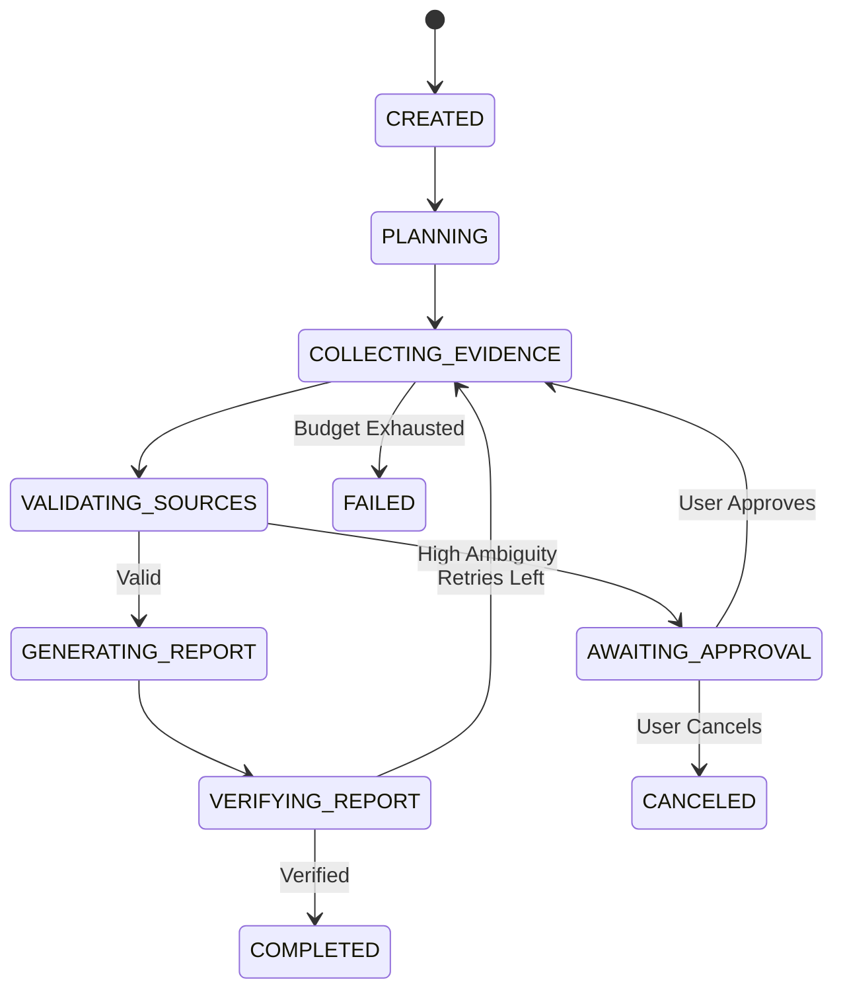

# System Architecture
## AI Research & Workflow Automation Agent (SLURBUILDS AI VAULT - Project 03)

### 1. High-Level Flow
```
User Request -> FastAPI Gateway (Auth + Ownership)
             -> LangGraph Stateful Graph (Postgres / Memory Checkpointer)
             -> Planner -> Query Generator -> Tool Executor (SSRF Guarded)
             -> Evidence Collector (Sanitizer + Deduplicator)
             -> Source Validator -> [Approval Gate if Ambiguous]
             -> Report Generator -> Fact & Citation Verifier
             -> Final Verified Report + Live SSE Stream
```

### 2. LangGraph State Machine


### 3. Core Architectural Modules
1. **API Gateway (`backend/api`)**:
   FastAPI with bearer token & API key authentication (`auth.py`). Validates request payloads and enforces user ownership.
2. **Agent Workflow Engine (`backend/agents`)**:
   Stateful LangGraph runtime holding `ResearchAgentState`. Implements deterministic node transitions, bounded retries, and checkpointing.
3. **Allowlisted Tools & Security (`backend/tools`)**:
   Strict tool allowlist (`registry.py`). Network isolation via `ssrf_guard.py` (resolving DNS, blocking RFC 1918, link-local, loopbacks, and AWS/GCP metadata `169.254.169.254`). Prompt injection sanitizer (`content_sanitizer.py`).
4. **Citation Entailment & Verifier (`backend/services/citation_verifier.py`)**:
   Two-stage validation: (1) Deterministic regex checks verifying citation IDs exist in source registry and match excerpts; (2) LLM-as-a-judge for semantic support.
5. **Observability & Evaluation (`evaluation/` + LangSmith)**:
   Distributed tracing across all graph nodes. 40-case offline benchmark with saved web fixtures, deterministic evaluation metrics, and LLM-as-a-judge calibration.
